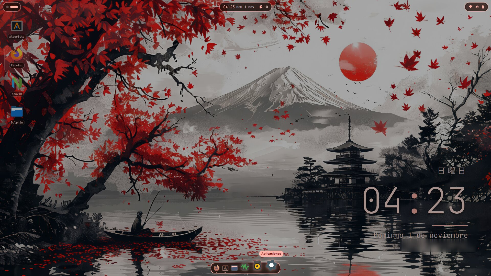
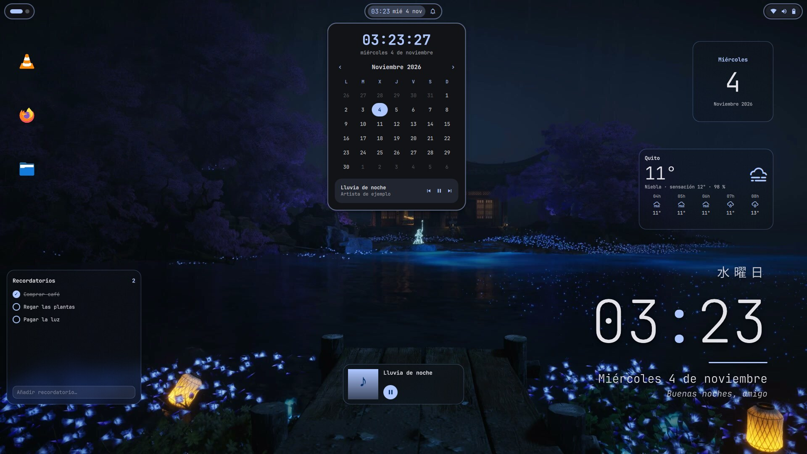
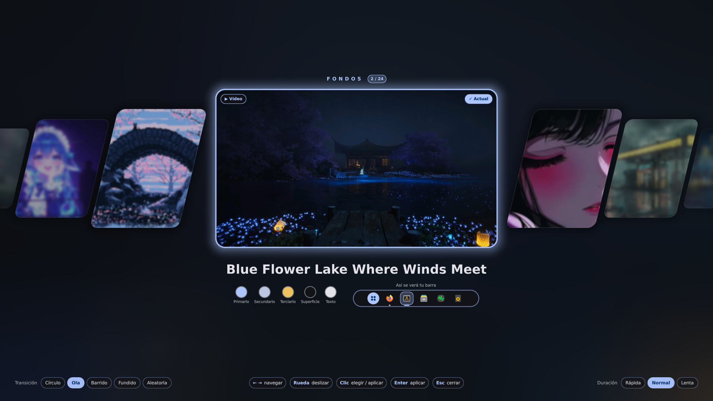
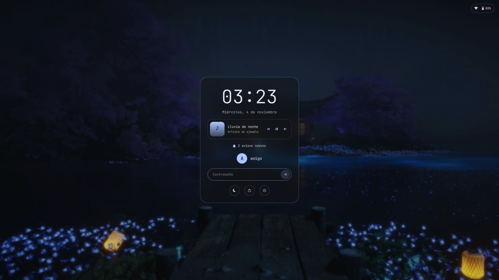
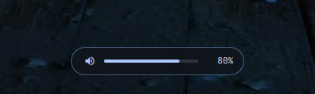

# niri-kde

Mi escritorio en **Arch Linux** con [niri](https://github.com/niri-wm/niri) (gestor de ventanas en
columnas desplazables) y una interfaz propia hecha con [Quickshell](https://quickshell.org): barra
superior en islas, dock, cajón de aplicaciones, portapapeles, galería de fondos con vídeo y
transiciones, escritorio personalizable con widgets, avisos, OSD y pantalla de bloqueo. Todo toma sus colores del fondo de pantalla con
[matugen](https://github.com/InioX/matugen): la interfaz, las apps GTK y Qt/KDE, la terminal, niri y
la pantalla de inicio de sesión.

Pensado para usarse **sin terminal**: casi todo tiene su panel.



| Calendario y música | Galería de fondos |
|---|---|
|  |  |

| Pantalla de bloqueo | OSD de volumen y brillo |
|---|---|
|  |  |

> Los fondos de las capturas no se incluyen en el repositorio (son de sus autores). El clima, los recordatorios, la música, los avisos y los nombres muestran datos de ejemplo.

## Qué incluye

Cada pieza es una instancia aparte de Quickshell (`~/.config/quickshell/<módulo>/shell.qml`) que
arranca niri:

| Módulo | Qué hace |
|---|---|
| `hola` | Barra superior en islas: workspaces y ventana activa · hora (calendario + música) y campanita (avisos, No molestar) · bandeja y píldora de estado (wifi, bluetooth, audio, sistema, energía, capturas y grabación, modos de energía, luz nocturna y límite de carga). Los paneles crecen desde su botón. Es también el servidor de notificaciones. Con una ventana a pantalla completa se esconde como en macOS: baja al acercar el mouse al borde de arriba. |
| `dock` | Dock flotante abajo, se oculta solo, efecto ola, puntito de apps abiertas, menú de clic derecho. |
| `cajon` | Cajón de aplicaciones con buscador. Mantén pulsada una app y arrástrala para dejarla en el escritorio. |
| `portapapeles` | Historial del portapapeles (texto e imágenes) estilo Win+V, que pega en la ventana anterior. |
| `escritorio` | Escritorio personalizable: widgets e iconos de `~/Desktop` sobre una cuadrícula, con un diseño propio por fondo si quieres (ver más abajo). |
| `galeria` | Galería de fondos (imágenes, vídeos y GIF): carrusel infinito, ancho y centrado. Las tarjetas laterales son paralelogramos que pierden opacidad y nitidez con la distancia; la del centro se endereza y crece. El vídeo o GIF elegido se reproduce solo en ella (decodificado en la GPU), sobre la imagen fija difuminada. Debajo, el nombre, la paleta y una maqueta de la barra con esos colores. Todo con un único shader. |
| `fondo` | Fondo de pantalla con transiciones por shader (círculo desde el clic, ola, barrido, fundido) y vídeo, que se pausa con ventanas maximizadas. |
| `osd` | Aviso discreto de volumen, micrófono, brillo y Bloq Mayús. |
| `bloqueo` | Pantalla de bloqueo (PAM) con música, avisos sin ver, batería y botones de energía; bloqueo automático por inactividad, que no salta mientras algo se reproduce. |
| `permisos` | Agente polkit: diálogo propio (en español) cuando una app pide la contraseña de administrador. |

Además:

- **Escritorio personalizable** (<kbd>Super</kbd>+<kbd>Shift</kbd>+<kbd>D</kbd> o clic derecho en un hueco): cuadrícula con arrastre y tamaños S, M y L, sin que nada se solape; con ventanas abiertas pasa a un workspace vacío y al salir vuelve.
  - **Widgets**: reloj japonés, calendario, clima ([Open-Meteo](https://open-meteo.com), sin cuenta ni API key), recordatorios locales y música (MPRIS), en tarjetas translúcidas con el desenfoque de niri. Cada uno tiene sus opciones en un engranaje. Se detienen si una ventana tapa el escritorio.
  - **Iconos**: cada archivo de `~/Desktop` se coloca por separado; uno nuevo va al primer hueco libre. Quitar un acceso directo no desinstala la app, y un archivo real va a la papelera tras confirmar.
  - **Grupos** como en el celular: mantén un icono 0,5 s sobre otro para agruparlos; se abren en un panel flotante donde puedes renombrarlos y meter o sacar iconos.
  - **Añadir**: selector con buscador de todas las apps instaladas (al escritorio o a un grupo) y catálogo de widgets.
- **Diseños por fondo**: al salir del modo edición eliges entre guardar solo para ese fondo, usarlo en todos o descartar. Al cambiar de fondo se carga su diseño, o el general si no tiene, con un fundido. Se puede volver al general en cualquier momento.
- **Inactividad y cafeína**: no se atenúa, bloquea ni suspende mientras un programa pide evitarlo, un reproductor está en marcha (MPRIS) o sale audio (PipeWire); sirve también para los vídeos con DRM, en ventana o a pantalla completa. Al pausar, el contador vuelve a correr. Además, la tarjeta **Mantener despierto** del panel activa una cafeína manual, con una taza en la barra que la apaga con un clic.
- **Pantalla completa como en macOS**: al poner una ventana a pantalla completa (F11, la F de YouTube o <kbd>Super</kbd>+<kbd>Shift</kbd>+<kbd>F</kbd>) la barra sube y deja todo el espacio a la ventana; baja encima al acercar el mouse al borde de arriba (con sus paneles) y el dock aparece desde el borde de abajo. Mientras dura, los avisos normales van directo al historial; los urgentes, el OSD, el portapapeles y el bloqueo siguen saliendo encima. Se detecta por monitor con el `event-stream` de niri.
- **Energía**: modos Ahorro / Equilibrado / Rendimiento (power-profiles-daemon) en el panel; **luz nocturna** con wlsunset que se enciende sola al ponerse el sol (o siempre), con su calidez ajustable y vista previa; **límite de carga al 80 %** con UPower (sin sudo ni contraseña: polkit lo permite al usuario de la sesión), con la salud de la batería. Pon tu latitud/longitud en `~/.config/quickshell/hola/luz-nocturna.json` (en el repo vienen en 0,0).
- **Terminal**: prompt de [starship](https://starship.rs) en píldoras redondeadas como la barra y [fastfetch](https://github.com/fastfetch-cli/fastfetch) en español, los dos con los colores del fondo (plantillas de matugen). fastfetch sale solo en la primera terminal que abras tú en la sesión con <kbd>Super</kbd>+<kbd>T</kbd>, el cajón o el dock (luego, escribiendo `fastfetch`); nunca por SSH, dentro de herramientas como Claude Code o VS Code, ni en terminales abiertas desde otras apps. No muestra usuario, equipo ni IP. Alacritty usa JetBrainsMono Nerd Font. `install.sh` añade una línea a `~/.bashrc` que carga `~/.config/bash/escritorio.sh`.
- **niri**: animaciones propias sin rebote (abrir/cerrar con shader), sombras y borde con los colores del fondo.
- **Modo infinito**: la navegación da la vuelta al llegar al extremo. <kbd>Super</kbd>+<kbd>U</kbd> / <kbd>I</kbd> y <kbd>Super</kbd>+rueda recorren los workspaces en ciclo, con el workspace vacío del final (donde se ve el escritorio) como una parada más; si no hay ventanas, no hacen nada. <kbd>Super</kbd>+<kbd>←</kbd> <kbd>→</kbd> recorre las columnas y <kbd>Super</kbd>+<kbd>↑</kbd> <kbd>↓</kbd> las ventanas de la columna. Con el touchpad, <kbd>Super</kbd> + dos dedos. **Límite de niri**: dentro de <kbd>Super</kbd>+<kbd>O</kbd> solo da la vuelta con <kbd>Super</kbd> pulsado, y los gestos de tres dedos no dan la vuelta en ningún caso.
- **matugen**: plantillas para Quickshell, niri, alacritty, fuzzel, swaylock, GTK 3/4 (adw-gtk3), Qt (qt5ct/qt6ct), KDE (`kdeglobals`) y SDDM.
- **Scripts** en `~/.local/bin`: `wallpaper.sh` (pone el fondo y regenera los colores), `fondo-fotograma.sh`, `fondo-arrancar.sh` (arranca el fondo con decodificación por hardware si puede), `fondo-optimizar.sh` (copia del vídeo a tamaño de pantalla), `fondo-login.sh` (pasa el fondo a la pantalla de inicio de sesión, aunque cambies de fondo o apagues enseguida), `aplicar-colores-apps.sh`, `bloquear.sh` y `workspace-circular.sh` (workspaces en ciclo).
- **SDDM**: tema [sddm-astronaut](https://github.com/Keyitdev/sddm-astronaut-theme) con un diseño propio (`Tarjeta.qml`) igual a la pantalla de bloqueo de Quickshell: tarjeta centrada translúcida, fondo actual (fotograma si es vídeo) difuminado, colores de matugen, fecha en español, campos de usuario y contraseña en pastilla, contador de intentos fallidos (5 → espera 2 min), selección de sesión y energía con cuenta atrás. Se guarda solo el parche, no el tema entero; para volver al diseño original: `MainScript=Main.qml` en `metadata.desktop`.

## Instalación

Requisitos: Arch Linux. **Todo viene de los repositorios oficiales**, no hace falta el AUR.

```bash
git clone https://github.com/Polaris09-1/niri-kde.git
cd niri-kde
./install.sh --simular   # muestra lo que haría, sin cambiar nada
./install.sh             # instala (pregunta antes de cada paso)
```

`install.sh`:

1. Instala los paquetes de [`paquetes.txt`](paquetes.txt) con `sudo pacman -S --needed`.
2. Copia los archivos de [`archivos.txt`](archivos.txt) a tu `$HOME`. **Antes de sobrescribir cualquier archivo lo respalda** en `~/respaldos-limpieza/<fecha>-niri-kde-install/`. Adapta las rutas y el nombre del saludo a tu usuario.
3. Instala el tema SDDM: clona sddm-astronaut en la versión probada, aplica el parche y lo elige en `/etc/sddm.conf.d/theme.conf` (respalda el anterior).

Opciones: `--sin-paquetes`, `--sin-sddm`, `--si` (no preguntar), `--ayuda`.
No lo ejecutes con `sudo`: el script pide la contraseña solo cuando la necesita.

Después:

1. Activa los servicios si hace falta: `sudo systemctl enable --now NetworkManager bluetooth power-profiles-daemon` (y `sudo systemctl enable sddm` si no usas otro gestor de inicio de sesión).
2. Copia imágenes o vídeos a `~/Pictures/wallpapers/`.
3. Cierra sesión, elige **niri** en SDDM y entra.
4. Abre la galería con <kbd>Super</kbd>+<kbd>Shift</kbd>+<kbd>W</kbd> y elige un fondo: matugen pintará todo con sus colores.
5. Pulsa <kbd>Super</kbd>+<kbd>Shift</kbd>+<kbd>D</kbd> para colocar tu escritorio. Si añades el clima, elige tu ciudad en su engranaje: el repositorio no trae ninguna.

## Atajos

<kbd>Super</kbd> es la tecla de Windows. <kbd>Super</kbd>+<kbd>Shift</kbd>+<kbd>/</kbd> muestra todos los atajos de niri.

### Del escritorio

| Atajo | Acción |
|---|---|
| <kbd>Super</kbd>+<kbd>A</kbd> | Cajón de aplicaciones |
| <kbd>Super</kbd>+<kbd>Shift</kbd>+<kbd>W</kbd> | Galería de fondos |
| <kbd>Super</kbd>+<kbd>Shift</kbd>+<kbd>D</kbd> | Personalizar el escritorio |
| <kbd>Super</kbd>+<kbd>V</kbd> | Historial del portapapeles (pega al elegir) |
| <kbd>Super</kbd>+<kbd>Shift</kbd>+<kbd>S</kbd> | Panel de capturas |
| <kbd>Impr</kbd> · <kbd>Ctrl</kbd>+<kbd>Impr</kbd> · <kbd>Alt</kbd>+<kbd>Impr</kbd> | Captura de área · pantalla · ventana |
| <kbd>Shift</kbd>+<kbd>Impr</kbd> | Grabar la pantalla (inicia/detiene) |
| <kbd>Super</kbd>+<kbd>Alt</kbd>+<kbd>L</kbd> | Bloquear la pantalla |
| <kbd>Ctrl</kbd>+<kbd>Alt</kbd>+<kbd>Shift</kbd>+<kbd>L</kbd> | Rescate del bloqueo (si la pantalla de bloqueo se colgara: cambia a swaylock) |
| <kbd>Super</kbd>+<kbd>T</kbd> · <kbd>Super</kbd>+<kbd>D</kbd> | Terminal (Alacritty) · lanzador (fuzzel) |
| Teclas de volumen, micro y brillo | Cambian el valor y muestran el OSD |
| Teclas multimedia | Reproducir/pausa, anterior, siguiente (playerctl) |

### Ventanas y workspaces (niri)

| Atajo | Acción |
|---|---|
| <kbd>Super</kbd>+<kbd>Q</kbd> | Cerrar la ventana |
| <kbd>Super</kbd>+<kbd>O</kbd> | Vista general de workspaces |
| <kbd>Super</kbd>+<kbd>←</kbd> <kbd>→</kbd> <kbd>↑</kbd> <kbd>↓</kbd> (o <kbd>H</kbd> <kbd>J</kbd> <kbd>K</kbd> <kbd>L</kbd>) | Mover el foco (da la vuelta entre columnas y dentro de la columna) |
| <kbd>Super</kbd>+<kbd>Ctrl</kbd>+flechas | Mover la ventana/columna |
| <kbd>Super</kbd>+<kbd>1</kbd>…<kbd>9</kbd> | Ir al workspace |
| <kbd>Super</kbd>+<kbd>Ctrl</kbd>+<kbd>1</kbd>…<kbd>9</kbd> | Mover la columna a ese workspace |
| <kbd>Super</kbd>+<kbd>U</kbd> / <kbd>I</kbd> (o <kbd>AvPág</kbd> / <kbd>RePág</kbd>) | Workspace de abajo / de arriba (da la vuelta) |
| <kbd>Super</kbd>+rueda del mouse | Cambiar de workspace (da la vuelta) |
| <kbd>Super</kbd> + dos dedos en el touchpad | Vertical: workspaces · horizontal: columnas (da la vuelta) |
| <kbd>Super</kbd>+<kbd>F</kbd> · <kbd>Super</kbd>+<kbd>Shift</kbd>+<kbd>F</kbd> | Maximizar la columna · pantalla completa |
| <kbd>Super</kbd>+<kbd>R</kbd> | Cambiar el ancho de la columna (1/3, 1/2, 2/3) |
| <kbd>Super</kbd>+<kbd>-</kbd> / <kbd>=</kbd> | Ancho −10 % / +10 % |
| <kbd>Super</kbd>+<kbd>C</kbd> | Centrar la columna |
| <kbd>Super</kbd>+<kbd>W</kbd> | Columna en pestañas |
| <kbd>Super</kbd>+<kbd>,</kbd> / <kbd>.</kbd> | Meter / sacar la ventana de la columna |
| <kbd>Super</kbd>+<kbd>Espacio</kbd> | Ventana flotante |
| <kbd>Super</kbd>+<kbd>Shift</kbd>+<kbd>P</kbd> | Apagar las pantallas |
| <kbd>Super</kbd>+<kbd>Shift</kbd>+<kbd>E</kbd> | Cerrar sesión |

## Mantener el repositorio al día

Cuando cambies algo en tu escritorio:

```bash
./sincronizar.sh           # copia tu configuración actual al repo (y revisa la privacidad)
git status && git diff     # mira qué cambió
git add -A && git commit -m "Describe el cambio"
git push
```

`sincronizar.sh` cambia tus datos personales por marcadores (`@HOME@`, `@NOMBRE@`) y al final
ejecuta [`revisar-privacidad.sh`](revisar-privacidad.sh), que busca llaves, tokens, correos,
direcciones MAC/IP, tu ruta personal, el nombre del equipo y **los nombres de tus redes Wi-Fi
guardadas**. Si avisa de algo, corrígelo antes de hacer `git push`.

Del escritorio **no se suben** tus recordatorios, la ciudad del clima, los nombres de tus archivos y
grupos ni el nombre del saludo. Sí se suben los widgets, su posición y los nombres de los fondos que
tengan un diseño propio.

## Estructura

```
niri-kde/
├── install.sh              instalador (con --simular y respaldo previo)
├── sincronizar.sh          sistema → repositorio
├── revisar-privacidad.sh   busca datos privados antes de subir
├── archivos.txt            qué archivos forman el escritorio
├── paquetes.txt            paquetes de los repos oficiales
├── LICENSE                 licencia GPL-3.0
├── home/                   los archivos, con la misma ruta que en $HOME
│   ├── .config/{niri,quickshell,matugen,alacritty,fuzzel,swaylock,qt5ct,qt6ct,environment.d}
│   ├── .config/{fastfetch,bash}   fastfetch y lo que carga ~/.bashrc (prompt y fastfetch)
│   ├── .config/starship.toml      prompt de la terminal
│   └── .local/{bin,share/{applications,dbus-1/services}}
├── sddm/                   parche del tema sddm-astronaut, tema niri-matugen y theme.conf
└── capturas/
```

## Licencia

[GPL-3.0](LICENSE). Los programas y temas de terceros que se usan aquí conservan sus propias licencias (ver Créditos).

## Créditos

- [niri](https://github.com/niri-wm/niri), [Quickshell](https://quickshell.org) y [matugen](https://github.com/InioX/matugen), con sus respectivas licencias.
- Tema SDDM: [sddm-astronaut-theme](https://github.com/Keyitdev/sddm-astronaut-theme) de Keyitdev (GPL-3.0). Aquí solo hay un parche sobre él.
- Fuente JetBrains Mono Nerd Font e iconos Papirus.
- Ideas tomadas de shells como Caelestia, DankMaterialShell, Noctalia e iNiR.
